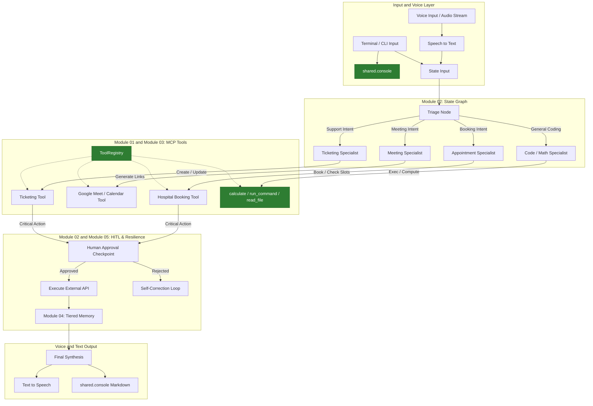

# System Knowledge Graph and Architecture Map

This document is the persistent memory and architecture map for the Agentic Systems lab. It records progress, component relationships, and milestones leading to the voice-driven appointment and ticketing agent.

---

## 1. System Knowledge Graph

---

## 2. Milestone Progression to Target Application

| Stage | Subsystem | Target Capability | Status |
| :--- | :--- | :--- | :--- |
| **Stage 1** | Module 01: Raw Loop | Zero-framework ReAct loop, Safe Tool Registry, context truncation | **COMPLETED** |
| **Stage 2** | Module 02: State Graph | Triage Router, Specialist nodes, Human-in-the-Loop approval checkpoints | **IN PROGRESS** |
| **Stage 3** | Module 03: Protocol (MCP) | Calendar Tools, Appointment Tools, Ticket Management Tools over MCP | Pending |
| **Stage 4** | Module 04: Tiered Memory | Persistent user/patient profiles, booking history, conflict resolution | Pending |
| **Stage 5** | Module 05: Durability | Crash-proof workflows so telephone/web calls do not drop state | Pending |
| **Stage 6** | Voice Streaming | Real-time speech pipeline (STT -> State Graph -> TTS audio playback) | Pending |

---

## 3. Component Inventory (Shipped So Far)

### `shared/console.py`
- Centralized terminal presentation engine with colorized traces, tool logs, observation formatting, and Markdown rendering.

### `modules/01_raw_loop/src/tools.py`
- `ToolRegistry`: Automatic Python function to OpenAI JSON schema conversion.
- `calculate`: Regex-sanitized math evaluation.
- `read_file`: Line-buffered file reader with safety limits.
- `run_command`: Subprocess runner with 10s timeouts.

### `modules/01_raw_loop/src/agent.py`
- `RawAgent`: Pure Python ReAct loop with Pydantic serialization (`model_dump(exclude_none=True)`), JSON error recovery, and strict engineering output contracts.

### `modules/01_raw_loop/tests/test_loop.py`
- Unit tests covering registry, schemas, error boundaries, and safe execution.

---

## 4. Architectural Decisions Log

- **ADR-001: Zero-Cost Policy**: All models must use free providers (Groq free tier with `qwen/qwen3.8-27b`, Google AI Studio Gemini Flash, OpenRouter free, or local Ollama). No paid subscriptions.
- **ADR-002: Closed-Loop Error Feedback**: Tools must never raise unhandled exceptions. Errors must return as observations to allow the model to self-correct.
- **ADR-003: Contract-Driven Output**: No emojis, no conversational cheerleading. Outputs must be structured, technical Markdown.
- **ADR-004: Modular Architecture**: Each learning stage is a standalone package with dedicated test suites and README guides.
