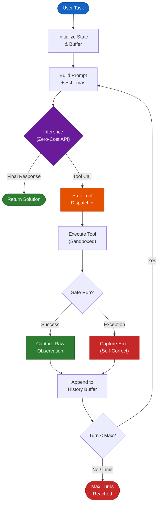

# Module 01: The Raw Loop (Zero-Framework ReAct)

> "Before you use a framework, write the loop by hand: call the model, call a tool, observe, repeat."

---

## 1. The Mental Model

An agent is fundamentally a stateful control loop:



Frameworks add abstraction, but in production, most failure modes happen inside this basic loop:
- Runaway cycles (agent repeatedly calling the same failing tool).
- Hallucinated tool parameters (e.g. invalid JSON, missing arguments).
- Context explosion (tool returns a large payload and crashes the context window).
- Silent failure to terminate or stop.

---

## 2. Mandatory Open-Source Code to Inspect

Before writing code, inspect these repositories from the Agentic Systems Atlas:

1. **SWE-agent/mini-swe-agent** (https://github.com/SWE-agent/mini-swe-agent)
   - Why: Shows how a capable software engineering agent can be written in roughly 100 lines of Python.
   - Look for: How bash is exposed as the sole tool and how terminal outputs are trimmed.
2. **huggingface/smolagents** (https://github.com/huggingface/smolagents)
   - Why: Contrasts JSON-based function calling with Python code actions (CodeAgent).
   - Look for: Why code-as-action is often more expressive than JSON payloads.
3. **anthropics/claude-cookbooks** (https://github.com/anthropics/claude-cookbooks)
   - Why: Notebooks illustrating core building blocks: Routing, Orchestrator-Workers, and Evaluator-Optimizer.

---

## 3. Your Self-Study Implementation Goals

Implement your own solution in `src/agent.py` and `src/tools.py`:

### Part A: Tool Registry and JSON Schemas
1. Create a mechanism or decorator that converts standard Python functions (type hints and docstrings) into OpenAI/Ollama compatible function calling schemas.
2. Build 3 essential tools:
   - `calculate(expression: str) -> str`: Safe math expression evaluation.
   - `read_file(filepath: str, max_lines: int = 50) -> str`: File reading with output truncation.
   - `run_command(cmd: str) -> str`: Shell execution with safety timeouts.

### Part B: The Resilient While-Loop
Implement `RawAgent.run(prompt: str, max_turns: int = 10)`:
1. Dispatch tool calls based on model response.
2. Catch tool exceptions (e.g., file not found, syntax error) and feed the error string back to the model as an observation so it can self-correct.
3. Detect repetitive loops (if the agent executes the identical tool call multiple times in a row, intervene with a prompt nudge).
4. Strictly enforce `max_turns` and token truncation limits.

---

## 4. Zero-Cost Free Provider Cheatsheet

All code in this repository uses the standard `openai` Python SDK. You can switch between any of these 4 free providers by simply changing `base_url`, `api_key`, and `model`:

```python
from openai import OpenAI

# Option A: Groq (Recommended - Free Tier, blazing fast tool calling)
client = OpenAI(
    base_url="https://api.groq.com/openai/v1",
    api_key=os.getenv("GROQ_API_KEY"),
)
model = "llama-3.3-70b-versatile"

# Option B: Google Gemini (Free Tier via OpenAI endpoint)
client = OpenAI(
    base_url="https://generativelanguage.googleapis.com/v1beta/openai/",
    api_key=os.getenv("GEMINI_API_KEY"),
)
model = "gemini-2.0-flash"

# Option C: OpenRouter (Free models)
client = OpenAI(
    base_url="https://openrouter.ai/api/v1",
    api_key=os.getenv("OPENROUTER_API_KEY"),
)
model = "meta-llama/llama-3.3-70b-instruct:free"

# Option D: Local Ollama (100% Free, Offline, No API key needed)
client = OpenAI(
    base_url="http://localhost:11434/v1",
    api_key="ollama",  # dummy key
)
model = "qwen2.5-coder:7b"
```

---

## 5. Acceptance Criteria

You have mastered this module when:
- Your agent can solve multi-step problems (e.g., "Find the largest file in the current directory, count its words, and calculate the square root of that count") autonomously.
- Your agent does not crash when a tool throws an unhandled exception; it reads the error observation and tries an alternative path.
- You can explain exactly how tool schemas, arguments, and role="tool" messages are structured over the wire.

