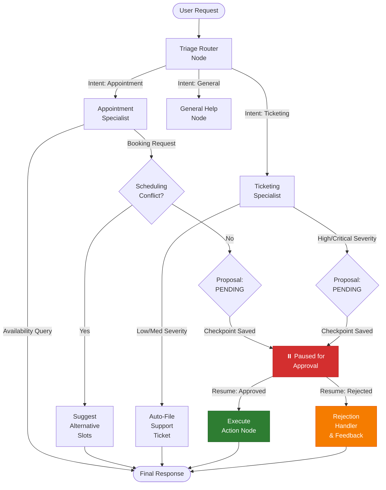

# Module 02: Orchestration and State Graphs

> "Know one graph-based framework deeply. Skim the rest to map the design space."

---

## 1. Objectives

- Move from unconstrained loops to typed, deterministic state graphs.
- Understand how graph abstractions contrast with raw procedural loops (Pydantic contracts vs LangGraph state machines, cycles, and interrupts).
- Implement explicit sub-agent handoffs (Triage Router to domain Specialist Agents).
- Build production-grade Human-in-the-Loop (HITL) checkpoints to safely intercept mutating actions before execution.

---

## 2. Key Repositories to Read Line-by-Line

- **pydantic/pydantic-ai** (https://github.com/pydantic/pydantic-ai): Study dependency injection, strict validation, and typed agent contracts.
- **langchain-ai/langgraph** (https://github.com/langchain-ai/langgraph): Study state transitions, cycles, and checkpoint persistence.
- **openai/openai-agents-python** (https://github.com/openai/openai-agents-python): Study minimal agent handoffs, guardrail primitives, and swarm routing.

---

## 3. Architecture & State Graph Blueprint



### Component Inventory

| Component | File | Responsibility |
| :--- | :--- | :--- |
| **Typed State Contracts** | [`src/state.py`](src/state.py) | Pydantic models: `AgentState`, `ActionProposal`, `ApprovalStatus`, `IntentType`. |
| **Domain Stores** | [`src/domain_tools.py`](src/domain_tools.py) | In-memory doctor scheduling calendars and support ticketing stores with conflict detection. |
| **StateGraph Engine** | [`src/graph.py`](src/graph.py) | First-principles directed graph engine, conditional branch routing, and checkpoint resume mechanics. |
| **Specialist Agents** | [`src/specialists.py`](src/specialists.py) | `triage_router_node`, `appointment_specialist_node`, `ticketing_specialist_node`, `action_executor_node`. |
| **Graph Assembly** | [`src/engine.py`](src/engine.py) | Compiles nodes and routing edges into an executable state machine. |
| **Latency Benchmark** | [`src/benchmark.py`](src/benchmark.py) | Microsecond-precision benchmark comparing StateGraph overhead against raw procedural loops. |

---

## 4. Hands-On Exercises

1. **Build a Type-Safe Triage System**:
   - Implement `triage_router_node` to classify incoming user utterances into typed domain intents (`appointment`, `ticketing`, `general`).
   - Route deterministically to specialist sub-agents without prompt pollution.

2. **Implement Human-in-the-Loop (HITL) Checkpoints**:
   - For high-risk or mutating actions (reserving clinical slots, filing critical IT outages), halt graph execution and serialize a checkpoint.
   - Resume execution with human feedback (`approved=True/False` + reviewer notes).

3. **Benchmark Latency Overhead**:
   - Measure the compute overhead added by the typed graph machinery versus a raw procedural loop.

---

## 5. Human-in-the-Loop (HITL) Mechanics

In production agentic architectures, automated agents **must never execute high-risk or irreversible mutations** (such as updating hospital records, filing critical outages, or charging cards) without an approval gateway.

### Checkpoint Lifecycle:
1. **Proposal Generation**: The specialist creates an `ActionProposal(status=ApprovalStatus.PENDING)` and attaches it to `state.pending_action`.
2. **Execution Halt**: `CompiledGraph.run()` detects the pending proposal, snapshots the entire `AgentState` into `checkpoints[session_id]`, and returns `(state, is_interrupted=True)`.
3. **Supervisor Review**: A human reviewer inspects the proposal via UI/CLI and responds with `approved: bool` and optional `reviewer_notes`.
4. **Resumed Execution**: Calling `graph.resume(session_id, approved=True/False)` resumes execution from the saved checkpoint, dispatching either to `action_executor` or `handle_rejection`.

```python
# 1. Initiate workflow
state = AgentState()
state.add_message("user", "Book Dr. Sarah Chen on 2026-10-15 at 09:00 for patient Mark Peterson")
paused_state, is_interrupted = graph.run(state)

assert is_interrupted is True

# 2. Human supervisor approves
resumed_state, _ = graph.resume(
    session_id=paused_state.session_id,
    approved=True,
    reviewer_notes="Medical record and insurance verified"
)
print(resumed_state.final_output)
# -> "Booking Confirmed: APT-20261015-0900 | Patient: Mark Peterson ..."
```

---

## 6. Framework Overhead Benchmark

Running `python modules/02_orchestration/src/benchmark.py` yields the following performance profile:

| Metric | Raw Procedural Baseline | Typed StateGraph Engine |
| :--- | :--- | :--- |
| **Average Latency per step** | ~0.17 µs | ~19.48 µs |
| **Transition Overhead** | Baseline | ~19.31 µs |
| **Impact on LLM Operations** | 0.00% | < 0.01% (LLM inference takes 150,000–500,000 µs) |

> **Conclusion**: The architectural guarantees of typed contracts, transition auditing, and interruptible checkpoints cost microsecond-level overhead while eliminating unconstrained failure modes.

---

## 7. Acceptance Criteria

- [x] You can explain what abstractions a state machine gives you over a raw loop, and what overhead it introduces (~19 µs).
- [x] You have built a working multi-agent graph with checkpoints, pause/resume approval gates, and state recovery.
- [x] All 8 unit tests in `tests/test_graph.py` pass deterministically offline at $0 cost.

---

## 8. Running Tests & Interactive Demo

```bash
# Run deterministic unit tests
./.venv/bin/pytest modules/02_orchestration/tests/ -v

# Run interactive Rich terminal demonstration
./.venv/bin/python modules/02_orchestration/run.py
```
